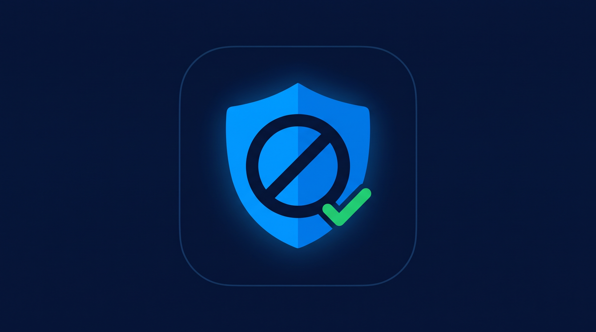

<div align="center">

**English** | [Русский](README_RU.md)



# BlockWave

A fast Android browser with a strong built-in ad blocker.

</div>

> Fork of [Lightning Browser](https://github.com/anthonycr/Lightning-Browser) (Mozilla Public License 2.0) with a
> stronger ad blocker: the bundled hosts-file blocker plus a downloadable EasyList engine.

### What it is

- **Normal browser**: tabs, history, bookmarks, downloads, file upload, fullscreen video, dark theme —
  inherited from Lightning Browser.
- **Ad blocking (on by default)**: two engines behind one switch —
  1. the bundled hosts file (`assets/hosts.txt`, domain-only, works offline on first launch);
  2. EasyList-style network rules downloaded at runtime (path, resource-type, per-domain and
     third-party aware). Core lists enabled by default: EasyList, RU AdList, EasyPrivacy.
     Settings → Ad blocking has a **Maximum** toggle that additionally enables Extended lists
     (EasyList Adult parts) — blocks more, but slower and some sites may break.
  Cosmetic rules (`##` selectors) are parsed from the same lists and injected as hiding CSS,
  so banners and popups that load from the page's own domain are hidden too. Procedural
  cosmetics (`#?#`, `#$#`) and regex rules are skipped. Blocked requests are answered with
  HTTP 404 (not an empty 200), so scripts, images, iframes and fetch() fail the way they
  would with a network-level blocker — this matters for ad-blocker detection scripts, which
  treat an empty 200 as a successful load.
- **Per-site toggle + counter**: open the Page Tools sheet (wrench icon) to allow/block ads for the
  current site; the header shows how many requests were blocked on the page.
- **Incognito mode**: built in (menu → "Incognito tab"). Incognito runs in a separate process,
  never writes history/bookmarks/autofill, does not restore tabs after the process dies, and wipes
  its session on exit. Ad blocking stays active in incognito; the blocked counter is in-memory
  only. Note: Android WebView has no true incognito API, so this is non-persistence + cleanup,
  and incognito does not hide your activity from the website, your ISP, or your router.
- **On any site**: blocking is domain-agnostic — it does not look at what a site is about, only
  at request URLs against filter lists. There is no special handling for adult sites; known adult
  ad/pop-under networks are covered by the same lists. Ads served from the same domain as the
  content, server-side ads, and anti-adblock walls are only partially coverable by lists.

### Build

Requirements: JDK 21+ (Gradle daemon toolchain), Android SDK platform 37 / build-tools 37.

```powershell
$env:JAVA_HOME = "C:\Program Files\Android\Android Studio\jbr"  # or any JDK 21+
.\gradlew.bat assembleLightningPlusDebug
```

APK: `app/build/outputs/apk/lightningPlus/debug/app-lightningPlus-debug.apk`
Unit tests: `.\gradlew.bat testLightningPlusDebugUnitTest`

Note: `gradle-wrapper.properties` is pinned to Gradle 9.6.0 (locally cached in this environment;
upstream is 9.8.2 — bump it when network access allows). `local.properties` with `sdk.dir` is a
machine-local file and must not be committed.

### Filter lists

Lists are downloaded at runtime to `filesDir/filterlists/` and never committed to git.
EasyList/EasyPrivacy come from easylist.to; the RU AdList parts come from the official
easylist/ruadlist GitHub repo; the EasyList Adult parts come from the official
easylist/easylist GitHub repo (the former easylistrussian.txt / Fanboy / AdGuard URLs
are dead or unreachable, hence the GitHub sources). List files are cached and refreshed
on launch when older than 24h, or manually from Settings → Ad blocking →
"Update filter lists now".

### Test results

- **adblock-tester.com: 100/100** (11 services, 22 checks)
- **adblock.turtlecute.org: 2/130** — the remaining checks there require a real network
  error from `fetch()`, which WebView's `shouldInterceptRequest` API cannot produce
  (it can only fake a successful response). This is an architectural limit of WebView,
  shared by DuckDuckGo and other WebView-based browsers.

### License

This fork is licensed under the Mozilla Public License 2.0 (see `LICENSE`), same as upstream
Lightning Browser. New code in `acr.browser.lightning.adblock.easylist` is also MPL-2.0.
You may rename the app and change its `applicationId` (this fork uses `com.noads.browser`,
app name "BlockWave"), but you must keep `LICENSE`, original copyright notices, and this
attribution — you may not claim authorship of upstream code. See `NOTICE`.
