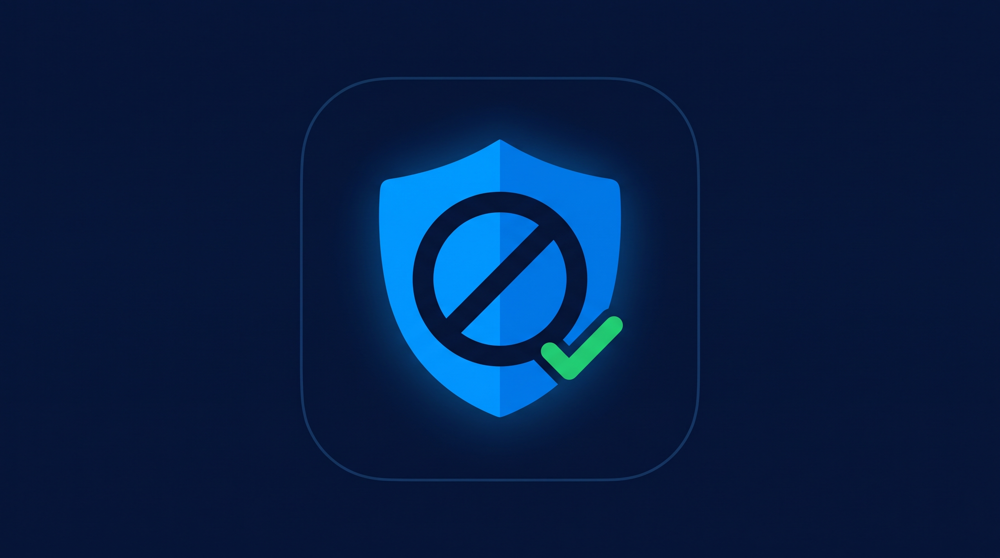

<div align="center">

[English](README.md) | **Русский**



# BlockWave

Быстрый браузер для Android с мощным встроенным блокировщиком рекламы.

</div>

> Форк [Lightning Browser](https://github.com/anthonycr/Lightning-Browser) (Mozilla Public License 2.0) с более сильным
> блокировщиком рекламы: встроенный hosts-файл + загружаемый движок EasyList.

### Что это

- **Нормальный браузер**: вкладки, история, закладки, загрузки, загрузка файлов на сайты,
  полноэкранное видео, тёмная тема — унаследовано от Lightning Browser.
- **Блокировка рекламы (включена по умолчанию)**: два движка за одним переключателем —
  1. встроенный hosts-файл (`assets/hosts.txt`, только по доменам, работает офлайн с первого запуска);
  2. сетевые правила в стиле EasyList, скачиваемые на лету (пути, типы ресурсов, привязка
     к доменам и third-party). Ядро по умолчанию: EasyList, RU AdList, EasyPrivacy.
     В настройках → Блокировка рекламы есть переключатель **Maximum** — дополнительно включает
     Extended-списки (части EasyList Adult): режет больше, но медленнее и часть сайтов может ломаться.
  Косметические правила (`##`-селекторы) парсятся из тех же списков и инжектятся как скрывающий
  CSS, поэтому баннеры и попапы с домена самой страницы тоже прячутся. Процедурные
  (`#?#`, `#$#`) и regex-правила пропускаются. Заблокированные запросы получают HTTP 404
  (а не пустой 200), поэтому скрипты, картинки и iframe получают событие ошибки. Учтите:
  `fetch()` считает 404 выполненным ответом (отклоняется только при настоящей сетевой
  ошибке), поэтому тесты, требующие от `fetch()` именно выброса ошибки, на WebView пройти
  не могут, — а пустой 200 выглядел бы «успешной загрузкой», поэтому используется 404.
- **Переключатель на сайте + счётчик**: откройте панель инструментов (иконка гаечного ключа),
  чтобы разрешить/заблокировать рекламу на текущем сайте; в заголовке видно, сколько запросов
  заблокировано на странице.
- **Инкогнито**: встроено (меню → «Инкогнито-вкладка»). Работает в отдельном процессе, не пишет
  историю/закладки/автозаполнение, не восстанавливает вкладки после смерти процесса и стирает
  сессию при выходе. Блокировка в инкогнито активна; счётчик только в памяти. Учтите: у Android
  WebView нет настоящего incognito-API, поэтому это имитация через несохранение + очистку, и
  инкогнито не скрывает активность от сайта, провайдера и роутера.
- **На любом сайте**: блокировка не зависит от категории сайта — только URL запросов против
  списков фильтров. Отдельной обработки «взрослых» сайтов нет: известные рекламные сети
  взрослых сайтов покрыты теми же списками. Рекламу с домена сайта, серверную рекламу и
  антирекламные стены списки покрывают лишь частично.

### Движок Gecko (эксперимент, фаза 2)

Браузер работает на системном WebView. Рядом существует экран на GeckoView 160: меню →
«Открыть в Gecko (бета)» открывает текущую страницу в Gecko-сессии со строгой защитой от
трекинга. Теперь это рабочий мини-браузер: несколько вкладок, назад/вперёд/обновить,
поделиться, обработка попапов. Блокировка использует общий движок EasyList — рекламные
попапы/фреймы без жеста пользователя отклоняются через колбэки навигации, а скрывающая
CSS-косметика инжектится через javascript:-URL (проверено: проверки «Block visibility»
проходят). Замер на устройстве: **71/100 на adblock-tester.com** — остаток требуют настоящей
сетевой блокировки подресурсов, которую стабильный GeckoView даёт только подписанным
расширениям. История/закладки/загрузки и переключатель на сайте пока на стороне WebView.
Следствия: minSdk 26 (Android 8.0), APK сильно вырос (нативные библиотеки Gecko; debug-сборки
только arm64, релиз — все ABI).

### Сборка

Требования: JDK 21+ (Gradle toolchain), Android SDK platform 37 / build-tools 37.

```powershell
$env:JAVA_HOME = "C:\Program Files\Android\Android Studio\jbr"  # или любой JDK 21+
.\gradlew.bat assembleLightningPlusDebug
```

APK: `app/build/outputs/apk/lightningPlus/debug/app-lightningPlus-debug.apk`
Юнит-тесты: `.\gradlew.bat testLightningPlusDebugUnitTest`

Примечание: `gradle-wrapper.properties` закреплён на Gradle 9.6.0 (локально закэширован
в этом окружении; апстрим — 9.8.2, обновите при доступности сети). `local.properties`
с `sdk.dir` — машинно-локальный файл, коммитить его нельзя.

### Списки фильтров

Списки скачиваются на лету в `filesDir/filterlists/` и никогда не коммитятся в git.
EasyList/EasyPrivacy — с easylist.to; части RU AdList — из официального репозитория
easylist/ruadlist на GitHub; части EasyList Adult — из официального easylist/easylist
(старые URL easylistrussian.txt / Fanboy / AdGuard мертвы или недоступны, поэтому GitHub).
Кэш обновляется при старте, если старше 24 ч, или вручную: Настройки → Блокировка рекламы →
«Обновить списки фильтров сейчас».

### Результаты тестов

- **adblock-tester.com: 100/100** (11 сервисов, 22 проверки)
- **adblock.turtlecute.org: 30/130** — оставшиеся проверки там требуют настоящей сетевой
  ошибки от `fetch()`, которую WebView `shouldInterceptRequest` не умеет давать
  (он умеет только подделывать «успешный» ответ). Это архитектурный лимит WebView,
  он же у DuckDuckGo и других WebView-браузеров.

### Лицензия

Форк лицензирован под Mozilla Public License 2.0 (см. `LICENSE`), как и апстрим Lightning
Browser. Новый код в `acr.browser.lightning.adblock.easylist` тоже MPL-2.0. Приложение можно
переименовывать и менять `applicationId` (здесь — `com.noads.browser`, имя «BlockWave»),
но `LICENSE`, оригинальные копирайты и эту атрибуцию сохранять обязательно — авторство
апстрим-кода присваивать нельзя. См. `NOTICE`.
